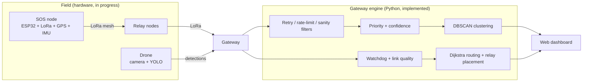

# Gods Hand

**LoRa mesh SOS system for flood scenarios: gateway engine, priority scoring, SOS validation, GPS refinement and web dashboard**


---

## Overview

Gods Hand is an emergency communication system for areas where cellular infrastructure is unavailable. Battery-powered end nodes send heartbeat and SOS packets over a multi-hop LoRa mesh to a gateway. The gateway software performs link-quality estimation, route computation, SOS validation, priority scoring, position estimation and incident clustering, and publishes the resulting state to a web dashboard. Drone-based person detection provides secondary verification of incidents.

This repository contains the gateway software, a network simulator, unit tests and the dashboard. Node firmware and drone integration are in progress (see [Status](#status-and-known-limitations)).

---

## System architecture



See [`docs/ARCHITECTURE.md`](docs/ARCHITECTURE.md) for the processing sequence and module details.

---

## Functional blocks

| Block | Function | Parameters |
|---|---|---|
| Link quality | Per-link score from SNR, RSSI and packet delivery ratio | SNR -20..10 dB, RSSI -120..-30 dBm, usable if LQ >= 0.10 |
| Node watchdog | Liveness tracking per node | Heartbeat period 45 s; STALE after 3 missed, LOST after 10 missed |
| Routing | Dijkstra on the live link graph, edge cost 1/LQ; alternate next hop on link failure | Undirected graph, LQ averaged when both ends report |
| Relay placement | Grid search for the point reachable from the live network that covers the most unreachable nodes | Radio range 450 m, grid step 25 m |
| Priority scoring | 0-100 score per SOS from six weighted components | See [scoring models](#scoring-models) |
| SOS validation | Retry detection by sequence number, per-node rate limiting, GPS sanity checks, cancel handling | Rate limit 6 presses / 60 s per node |
| Position estimation | HDOP/satellite gating, per-axis Kalman filter, uncertainty radius growth, neighbour-centroid fallback | HDOP <= 5, >= 4 satellites, uncertainty growth 1.5 m/s |
| Clustering | DBSCAN over SOS positions | eps 40 m, min_samples 2 |
| Drone verification | Multi-frame voting and node matching | 3 of 5 frames at confidence >= 0.6, match radius 20 m, 0.4-0.6 reported as possible |
| Confidence ladder | Dispatch / verify / unverified decision | >= 0.65 DISPATCH, >= 0.40 VERIFY_WITH_DRONE, else UNVERIFIED |

**Invalid GPS handling:** an SOS packet that fails the position checks is not discarded. The gateway substitutes the last valid position, sets GPS quality to 0 and lowers the confidence score, which routes the incident to drone verification. Only retransmissions, cancelled alerts and rate-limited packets are dropped.

---

## Gateway dashboard

Web dashboard built on Leaflet with OpenStreetMap and Esri imagery layers (dark, streets, satellite). Coordinates are displayed as decimal degrees with six decimals.

| View | Content |
|---|---|
| **Incidents** | On a new SOS the map is centred on the reported position, a priority-coloured marker is placed, and an incident record is opened |
| **Incident record** | Person name, age, blood group, medical notes, phone, address, emergency contact; device serial number, node ID, battery level and health state; latitude, longitude, GPS status; cause of SOS and flags; press time and elapsed time; mesh route; confidence and decision |
| **Priority queue** | Slide-out panel listing all active SOS devices sorted by priority; selecting an entry centres the map on it and opens its record |
| **Topology** | All registered nodes with links coloured by link quality, animated packet flow along computed routes, STALE/LOST nodes in gray with uncertainty radius, suggested relay point |

The device registry (`dashboard/registry.json`) contains fictional sample records for demonstration.

---

## Scoring models

```text
Priority   = 30*urgency + 20*vulnerability + 15*battery_risk
           + 15*repeat_presses + 10*wait_time + 10*drone_confirmed      range 0-100

LQ         = 0.5*norm(SNR) + 0.3*norm(RSSI) + 0.2*PDR                    edge cost = 1/LQ

Confidence = 0.35*GPS_quality + 0.20*repeat_consistency
           + 0.15*motion + 0.30*CV_confirmation
```

| Priority component | Definition |
|---|---|
| urgency | medical 1.0, trapped 0.8, supplies 0.4 |
| vulnerability | child / elderly / injured 0.5 each, capped at 1.0 |
| battery_risk | 1 - battery / 100 |
| repeat_presses | min(presses, 5) / 5 |
| wait_time | min(age, 1800 s) / 1800 |
| drone_confirmed | 1 if confirmed by drone, else 0 |

Priority colour mapping: red >= 80, orange 50-79, yellow < 50.

`priority.py` and `link_quality.py` include integer Q8 fixed-point implementations as reference models for firmware verification. All weights, caps and thresholds are configurable starting values and have not been calibrated against field data.

---

## Build and run

Requirements: Python 3.9+ and an internet connection for map tiles. No third-party Python packages.

### Windows

Run `START_HERE.bat`. It executes the simulator, starts a local HTTP server and opens `http://localhost:8000`.

If the file is blocked after download: right-click the zip, open Properties, select Unblock, and extract again.

### Any platform

```bash
git clone https://github.com/dracsInfi19/Gods-Hand.git
cd Gods-Hand

python -m sosmesh.simulator                       # writes dashboard/frames.json
python -m http.server 8000 --directory dashboard  # serves the dashboard
```

Open <http://localhost:8000>. The **Location** control sets the map origin used to convert local coordinates to latitude/longitude.

### Tests

```bash
python -m unittest discover -s tests -v
```

---

## Simulation scenario

`python -m sosmesh.simulator` runs a 12-node deployment (1 gateway, 11 nodes, 450 m radio range, 45 s heartbeat period) and prints the engine decisions:

- Route and cost from each node to the gateway
- SOS inputs: medical, trapped and supply requests; a retransmission; a second press; a cancelled alert; a 12-press burst from one node (rate limited); a packet with HDOP 9 (position fallback)
- Drone detections: below-threshold, confirmed with node match, confirmed without node
- Priority re-ordering as battery level decreases and wait time increases
- Failure of node 3 (alternate next hop), then node 4 (nodes 5, 6, 7 unreachable, relay point computed)

Output is written to `dashboard/frames.json` (one gateway snapshot per 45 s step).

---

## Repository layout

```text
Gods-Hand/
├── sosmesh/                 # gateway engine (Python standard library only)
│   ├── models.py            #   Heartbeat, SosPacket, LinkStats
│   ├── link_quality.py      #   LQ score (float and Q8)
│   ├── watchdog.py          #   ACTIVE / STALE / LOST state per node
│   ├── routing.py           #   link graph, Dijkstra, alternate hop, relay placement
│   ├── priority.py          #   priority score (float and Q8)
│   ├── filters.py           #   button logic, store-and-forward, spam, sanity, confidence
│   ├── gps.py               #   HDOP gate, Kalman filter, uncertainty, fallback
│   ├── clustering.py        #   DBSCAN
│   ├── gateway.py           #   state, drone voting, dashboard snapshot
│   └── simulator.py         #   scenario runner
├── dashboard/
│   ├── index.html           # web dashboard (Leaflet)
│   └── registry.json        # sample device registry (fictional records)
├── tests/test_all.py        # 23 unit tests
├── docs/ARCHITECTURE.md
└── START_HERE.bat           # Windows launcher
```

---

## Status and known limitations

- Dashboard data currently originates from the simulator. The system has not been run on physical radios.
- Simulated link quality is derived from a distance-based formula and does not model real LoRa propagation.
- The gateway cannot distinguish a failed node from a partitioned one; the suggested relay point is an estimate until a drone is in position.
- The Dispatch control in the dashboard updates the UI only and does not send notifications.
- Map tiles are loaded from third-party servers (OpenStreetMap, Esri).

## Roadmap

- [x] Gateway engine: link quality, routing, watchdog, priority, filters, GPS, clustering
- [x] Simulator and 23 unit tests
- [x] Web dashboard: map, incident records, priority queue, topology view
- [ ] Packet format: byte layout and CRC for heartbeat, SOS and ACK
- [ ] Gateway server: serial bridge feeding the dashboard with live data
- [ ] Node firmware: ESP32, LoRa, GPS, accelerometer, 3 s hold button
- [ ] Multi-hop forwarding on physical radios
- [ ] Drone pipeline: YOLO detection, pixel-to-GPS geo-tagging, object tracking, precision/recall metrics
- [ ] Metrics: reroute latency, packet delivery ratio, false-alarm rate

---

## Technology

Python 3 (standard library), Leaflet, OpenStreetMap, JavaScript (no framework).

## License

MIT. See [LICENSE](LICENSE).

## Author

Adarsh S Vajrawad ([@dracsInfi19](https://github.com/dracsInfi19))
