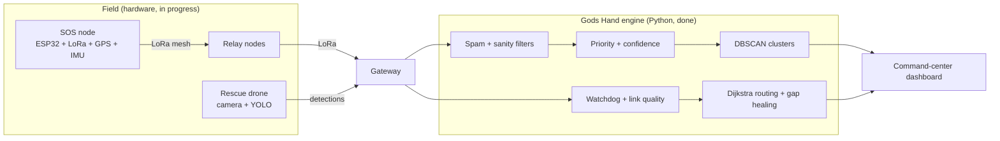

<div align="center">

# 🛟 GODS HAND

### Off-grid flood-rescue SOS mesh with a real-map command center

*When the towers go down, the mesh stays up. Every press of an SOS button becomes a ranked, verified, located incident a rescue team can act on.*


**Hackathon project** · LoRa mesh · priority engine · false-alarm filtering · drone verification

</div>

---

## The problem

During floods, mobile networks are the first thing to fail, and the people who most need help can no longer call for it. Rescue teams then face a second problem: a flood of unverified, duplicated and unranked distress signals, with no way to tell who to reach first.

## The idea

**Gods Hand** is a battery-powered SOS device network that talks over a LoRa radio mesh, plus a gateway brain that turns raw packets into decisions:

1. A person holds the SOS button on their device.
2. The packet hops node to node through the mesh until it reaches the gateway.
3. The gateway filters false alarms, scores the priority, fixes the location, and (optionally) asks a drone to verify.
4. The command center flies the map to the incident and opens a full incident card.

---

## Features

| Area | What it does |
|---|---|
| **Mesh health** | Heartbeat watchdog (active → stale after 3 missed → lost), live link graph, link-quality score, Dijkstra routing with cost `1/LQ`, instant alternate next-hop when a path dies |
| **Gap healing** | If a cluster is cut off, suggests the best spot to station a drone as a temporary relay |
| **Priority engine** | Every SOS scored 0–100 from urgency, vulnerability, battery risk, repeat presses, waiting time and drone confirmation |
| **Clustering** | DBSCAN groups nearby pins, so rescuers see "3 people in one area" instead of 3 pins |
| **False-alarm filtering** | 3-second hold or double press, retry vs. repeat-press detection, spam rate limiting, GPS sanity checks, cancel button, confidence score and a dispatch / verify / unverified ladder |
| **Location precision** | HDOP gating, Kalman smoothing, growing uncertainty circle when GPS is lost, neighbour-centroid fallback, drone-refined coordinates |
| **Drone verification** | Multi-frame voting (3 of 5 frames), node-match within 20 m, survivors spotted with no node |
| **Command center** | Dark, real-GPS-map dashboard with incident cards, a priority drawer and a live mesh-network view |

> **Safety rule:** an SOS is never dropped because of bad GPS. It falls back to the last good position, gets low confidence, and is sent for drone verification instead. Only retries, cancels and rate-limited spam are discarded.

---

## Command center

| View | What you see |
|---|---|
| **Emergency** (default) | When an SOS arrives the map **flies to the location**, drops a **priority-coloured pin**, sounds an alert and opens an **incident card** |
| **Incident card** | Person name, age, blood group, medical notes, phone, address and emergency contact · **hardware serial number**, node ID, **battery health** · latitude / longitude and GPS trust · **cause of SOS** · time pressed and time waiting · mesh route · confidence and decision |
| **Priority queue** | A slide-out drawer listing every active SOS device, ranked by priority. Click any row to fly to that person |
| **Mesh network** | All registered nodes on the real map with links colour-coded by quality, animated packets travelling to the gateway, lost nodes shown gray with their uncertainty circle, and the suggested drone relay point |

Map layers: dark (OpenStreetMap, restyled), streets, satellite. All coordinates are shown to six decimals.

> ⚠️ The people in `dashboard/registry.json` are **fictional demo data**.

---

## Architecture



See [`docs/ARCHITECTURE.md`](docs/ARCHITECTURE.md) for the data flow and the maths.

---

## Quick start

No installs needed beyond **Python 3.9+** and an internet connection (for the map tiles).

### Windows, one click

Double-click **`START_HERE.bat`**. It runs the simulator, starts a local server and opens the dashboard at `http://localhost:8000`.

> If Windows blocks the file because it was downloaded: right-click the zip → **Properties** → tick **Unblock** → extract again.

### Any OS

```bash
git clone https://github.com/dracsInfi19/Gods-Hand.git
cd Gods-Hand

python -m sosmesh.simulator                      # runs the scenario, writes dashboard/frames.json
python -m http.server 8000 --directory dashboard # serve the dashboard
```

Then open <http://localhost:8000>. Use **📍 Location** to move the demo onto your own coordinates.

### Run the tests

```bash
python -m unittest discover -s tests -v
```

---

## The demo scenario

`python -m sosmesh.simulator` replays a 12-node deployment and prints what the engine decides:

- Routes from every node to the gateway with their `1/LQ` costs
- An SOS wave: medical, trapped and supply requests, a retry, a second press, an accidental press that gets cancelled, a 12-press spam burst that gets rate-limited, and an SOS with a bad GPS fix
- Drone detections: possible, confirmed with a node match, and a survivor with no node nearby
- Priorities re-ordering as batteries drain and waiting time grows
- Node 3 dying and traffic re-routing, then node 4 dying so three nodes are cut off and a drone relay point is proposed

---

## How the scores work

```text
Priority   = 30·urgency + 20·vulnerability + 15·battery_risk
           + 15·repeat_presses + 10·wait_time + 10·drone_confirmed        (0–100)

Link LQ    = 0.5·norm(SNR) + 0.3·norm(RSSI) + 0.2·delivery_rate           edge cost = 1/LQ

Confidence = 0.35·GPS_quality + 0.20·repeat_consistency
           + 0.15·motion + 0.30·CV_confirmation
             ≥ 0.65 DISPATCH · ≥ 0.40 VERIFY WITH DRONE · else UNVERIFIED
```

The priority and link-quality functions each have an integer **Q8** version next to the float one, ready to be checked against firmware or RTL. The weights, caps and thresholds are tunable starting points, not field-calibrated values.

---

## Repository layout

```text
Gods-Hand/
├── sosmesh/                 # the engine (pure Python, standard library only)
│   ├── models.py            #   Heartbeat / SosPacket / LinkStats
│   ├── link_quality.py      #   LQ score (float + Q8)
│   ├── watchdog.py          #   ACTIVE / STALE / LOST per node
│   ├── routing.py           #   mesh graph, Dijkstra, alternate hop, gap healing
│   ├── priority.py          #   0–100 priority (float + Q8)
│   ├── filters.py           #   2-step button, store-and-forward, spam, sanity, confidence
│   ├── gps.py               #   HDOP gate, Kalman, uncertainty, fallback
│   ├── clustering.py        #   DBSCAN
│   ├── gateway.py           #   wires everything, drone voting, dashboard snapshot
│   └── simulator.py         #   end-to-end scenario
├── dashboard/
│   ├── index.html           # command-center UI (Leaflet)
│   └── registry.json        # demo device registry (fictional people)
├── tests/test_all.py        # 23 unit tests
├── docs/ARCHITECTURE.md
└── START_HERE.bat           # Windows one-click launcher
```

---

## Roadmap

- [x] Software engine: link quality, routing, watchdog, priority, filters, GPS, clustering
- [x] End-to-end simulator and 23 unit tests
- [x] Real-map command center with incident cards, priority drawer and mesh view
- [ ] Wire format: byte layout and CRC for heartbeat, SOS and ACK packets
- [ ] Gateway server: serial bridge so real devices feed the dashboard live
- [ ] SOS node firmware (ESP32 + LoRa + GPS + accelerometer, 3 s hold button)
- [ ] Multi-hop mesh forwarding on real radios
- [ ] Drone pipeline: YOLO person detection, pixel-to-GPS geo-tagging, tracking, precision/recall panel
- [ ] Metrics panel: reroute time, delivery rate, false-alarm counts

## Honest limitations

- All data in the dashboard currently comes from the **simulator**. Nothing has run on real radios yet.
- The simulated radio links use a simple distance formula, not real LoRa behaviour.
- The gateway cannot tell a dead node from a cut-off one, so the suggested relay point is a best guess until the drone arrives.
- The **Dispatch** button only changes the screen; it does not notify anyone.
- Map tiles come from third-party servers (OpenStreetMap, Esri) and need an internet connection.

---

## Built with

Python 3 (standard library) · Leaflet · OpenStreetMap · vanilla JavaScript

## License

MIT, see [LICENSE](LICENSE).

## Author

**Adarsh S Vajrawad** · [@dracsInfi19](https://github.com/dracsInfi19)
