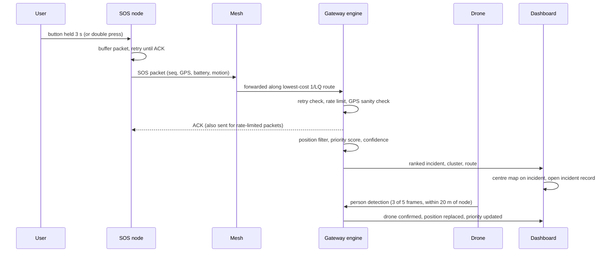

# Architecture

## 1. SOS processing sequence

## 2. Engine modules

| Module | Responsibility | Method |
|---|---|---|
| `link_quality` | Link score 0-1 | Weighted SNR, RSSI and delivery ratio; integer Q8 implementation |
| `watchdog` | Node liveness | Per-node state machine: ACTIVE, STALE (3 missed), LOST (10 missed) |
| `routing` | Path selection and relay placement | Dijkstra with cost 1/LQ; alternate hop by excluding the failed neighbour; relay point maximises covered unreachable nodes |
| `priority` | Incident ranking | Six weighted components, range 0-100, integer Q8 implementation |
| `filters` | SOS validation | Sequence-based retry detection, per-node rate limit, sanity checks, confidence thresholds |
| `gps` | Position estimate | HDOP gate, per-axis Kalman filter, uncertainty radius growing with time since last fix |
| `clustering` | Spatial grouping | DBSCAN, eps 40 m; unclustered points reported as single-device clusters |
| `gateway` | State and orchestration | Holds all state, merges drone detections, generates dashboard snapshots |

## 3. Retransmission versus repeated press

A node retransmits an unacknowledged packet with the **same sequence number**. The gateway treats a repeated sequence number as a retransmission and ignores it. A **new** sequence number from the same node is a repeated press and increments the `repeat_presses` component. This prevents radio retransmissions from inflating priority.

## 4. Invalid GPS handling

A position fix is accepted only if it passes all checks: valid coordinates, HDOP <= 5, at least 4 satellites, inside the configured zone radius, and no speed jump above 40 m/s relative to the previous fix. If a check fails, the SOS is still registered. The gateway substitutes the last valid position (or the last heartbeat position), sets GPS quality to 0, and the resulting low confidence selects drone verification.

## 5. Dashboard data format

`Gateway.snapshot(t)` returns one JSON-serialisable frame:

| Key | Content |
|---|---|
| `nodes` | id, state, last known position, battery, uncertainty radius |
| `links` | `[node_a, node_b, LQ]` for each usable link |
| `routes` | per node: path to gateway and total cost |
| `sos` | ranked incidents: priority, colour, confidence, decision, position, battery, press count, drone status, age |
| `clusters` | device count, centroid, maximum priority |
| `relay` | suggested relay position and covered node IDs |
| `unmatched_survivors` | drone detections with no nearby SOS node |

The simulator stores a list of frames in `dashboard/frames.json`. A live gateway server is expected to serve the same structure.

## 6. Planned hardware

| Component | Planned parts |
|---|---|
| SOS node | ESP32 with LoRa transceiver, GPS module, accelerometer, hold button, cancel button, LiPo battery |
| Gateway | ESP32 with LoRa transceiver connected over USB to a host (laptop or Raspberry Pi) running the engine |
| Drone | Camera-equipped drone, YOLO person detection, optional LoRa relay node |
