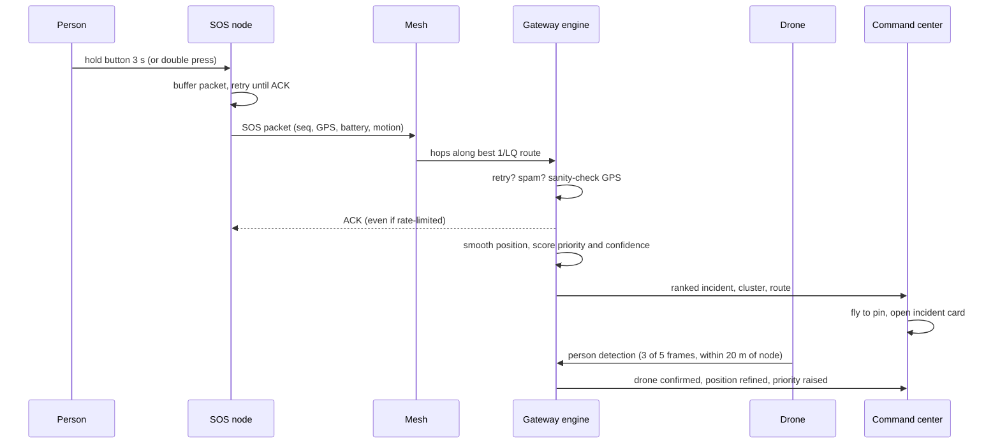

# Architecture

## 1. SOS life cycle

## 2. Engine modules

| Module | Responsibility | Key idea |
|---|---|---|
| `link_quality` | Score each radio link 0–1 | Weighted SNR, RSSI and delivery rate; integer Q8 version |
| `watchdog` | Track node liveness | One tiny state machine per node: ACTIVE → STALE (3 missed) → LOST (10 missed) |
| `routing` | Pick paths and heal gaps | Dijkstra on cost `1/LQ`; alternate hop; relay point = reachable from the live network and covering the most missing nodes |
| `priority` | Rank incidents | Six weighted components, 0–100, integer Q8 version |
| `filters` | Separate real from false alarms | Seq-based retry detection, per-node rate limit, sanity checks, confidence ladder |
| `gps` | Trustworthy position | HDOP gate, per-axis Kalman filter, uncertainty that grows without a fix |
| `clustering` | Group nearby people | DBSCAN with 40 m radius; noise points become clusters of one |
| `gateway` | Orchestration | Owns all state, merges drone detections, produces the dashboard snapshot |

## 3. Retry vs. repeat press

A node resends the **same sequence number** until it gets an ACK, so a repeated `seq` is a retry and is ignored. A **new** `seq` is a real extra press, which raises the priority. This stops a flaky radio from inflating priorities.

## 4. Never lose an SOS

A fix is trusted only if it passes every check (valid coordinates, HDOP ≤ 5, at least 4 satellites, inside the flood zone, no impossible jump). If it fails, the SOS is still accepted. The gateway falls back to the last good position, sets GPS quality to zero, and the confidence ladder routes it to drone verification.

## 5. Dashboard data contract

`gateway.snapshot(t)` returns one JSON frame: `nodes`, `links`, `routes`, `sos` (ranked), `clusters`, `relay`, `unmatched_survivors`. The simulator saves a list of frames to `dashboard/frames.json`; a live gateway server would serve the same shape.

## 6. Planned hardware split

| Piece | Planned parts |
|---|---|
| SOS node | ESP32 with LoRa, GPS module, accelerometer, hold button, cancel button, LiPo battery |
| Gateway | ESP32 with LoRa on USB to a laptop or Raspberry Pi running this engine |
| Drone | Small drone with a camera, YOLO detection, optional LoRa relay node |
